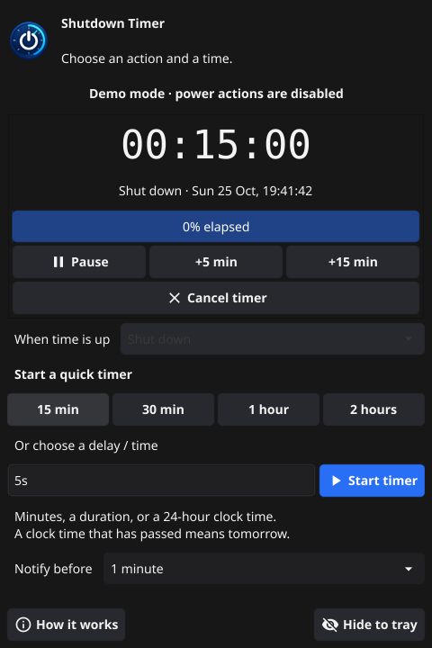

# Shutdown Timer


A small Linux desktop timer. Choose **shut down, restart, sleep, hibernate,
or log out**, then start a preset or enter a delay / clock time.

On KDE Plasma, shutdown, restart and logout go through KDE's session manager.
This respects your session-restore settings and gives apps a chance to close
normally, including unsaved-work prompts. It fixes the old timer's direct
system shutdown, which could leave KDE restoring an older saved session.



## Install

1. Download `ShutdownTimer.tar.gz` from the
   [latest release](https://github.com/cynd22/shutdown-timer/releases/latest)
   and extract it.
2. Run `bash install.sh` in the extracted folder.
3. Open **Shutdown Timer** from your application menu.

Updating uses the same steps. Quit any running older copy before reopening.
Everything installs in your user folders; no sudo or compiler is needed to
use the release. The executable uses your system's standard graphics libraries.

To run without installing: `./shutdown-timer`.

## Timer controls

- **15 min / 30 min / 1 hour / 2 hours** start immediately.
- **Start timer**, or Enter in the custom box, starts a custom timer.
- **Pause / Resume** freezes and resumes the remaining time.
- **+5 min / +15 min** adds time, including while paused.
- **Cancel timer** clears it. Starting another timer replaces the old one.
- The large countdown, progress bar and window title show its state.
- **Notify before** sends a desktop notification 30 seconds, 1 minute, or
  5 minutes before the action; choose Off to disable it. Notifications do
  not delay the action and follow your desktop's notification settings.
- **Hide to tray** keeps the timer running. The tray menu can show, pause,
  extend or cancel it. Closing the window asks before cancelling an active
  timer. Quitting cancels it.

The selected action stays locked while a timer is armed, so the visible action
always matches what will happen. Cancel first to change it. Your last action,
custom input and notification choice are remembered; a running timer is never
saved or restarted at login.

| Custom input | Meaning |
|---|---|
| `45` | 45 minutes from now |
| `90m` | 90 minutes from now |
| `1h30m` or `1h 30m` | 1 hour 30 minutes from now |
| `45s` | 45 seconds from now |
| `23:30` | Next local 23:30, today or tomorrow |

Clock times follow the local calendar across daylight-saving changes. Times
skipped by a clock change are rejected. Delays must be positive and at most
365 days. The timer catches up when the computer resumes from sleep; it
cannot wake a sleeping computer.

## KDE session behavior

The app uses `org.kde.Shutdown.logoutAndShutdown` (or the matching reboot /
logout method) over the session D-Bus, waiting for a reply. KDE's separate
confirmation dialog is skipped, so the timer can run unattended. Apps can
still delay or cancel logout to protect unsaved work. A successful request
means KDE accepted it, not that every app has finished closing.

Older Plasma versions fall back to `org.kde.KSMServerInterface.logout`.
If neither KDE API exists, shutdown retains the original command fallbacks:
`systemctl poweroff`, `shutdown now`, then `poweroff`. Other desktops use
those commands directly. A KDE timeout, permission denial or broken session
bus is shown as an error instead of bypassing KDE's session handling.

KDE still controls whether it restores the previous logout, a manually saved
session, or an empty session. This app does not edit `ksmserverrc` or app
autostart settings, and cannot guarantee that an app never reopens for other
reasons. KDE's shutdown implementation is documented in its
[source](https://invent.kde.org/plasma/plasma-workspace/-/blob/master/startkde/plasma-shutdown/shutdown.cpp).

Sleep and hibernate require system support. Logout is available on KDE only.
Power actions normally need no password in an active desktop login. If one
fails, the app shows the error; check your desktop's permissions and support
for that action.

## Try it without powering off

```bash
./shutdown-timer --demo
```

Demo mode has its own preferences and the same controls, but **never sends a
power request**. Enter `5s` to watch it complete harmlessly.

## Build and test

Use the Go version in `go.mod` or later, a C compiler, and the X11 / OpenGL
development headers [required by Fyne](https://docs.fyne.io/started/).

```bash
make build VERSION=1.1.0
make test
make package VERSION=1.1.0
```

Or build directly: `go build -trimpath -ldflags "-s -w" -o shutdown-timer .`

`make test` runs the timer, parser, UI and power-routing tests under the race
detector plus `go vet`. Tests never invoke power commands; D-Bus integration
uses a private mock session bus. `make package` creates `dist/ShutdownTimer.tar.gz`
and a SHA-256 checksum. GitHub Actions runs the checks and uploads a Linux
x86_64 installer archive for each master push / pull request.

The generated icon is embedded in the executable and installed for the app
launcher. Its generation prompt is in [assets/icon-prompt.txt](assets/icon-prompt.txt).

## Uninstall

```bash
rm -f ~/.local/bin/shutdown-timer \
      ~/.local/share/applications/shutdown-timer.desktop \
      ~/.local/share/icons/shutdown-timer.png
```

The installer respects `XDG_DATA_HOME`; `XDG_BIN_HOME` optionally overrides
the executable directory. If you used these, remove the corresponding files
there. Optional preferences are under
`${XDG_CONFIG_HOME:-~/.config}/fyne/io.github.cynd22.shutdown-timer/`.

## License

MIT
